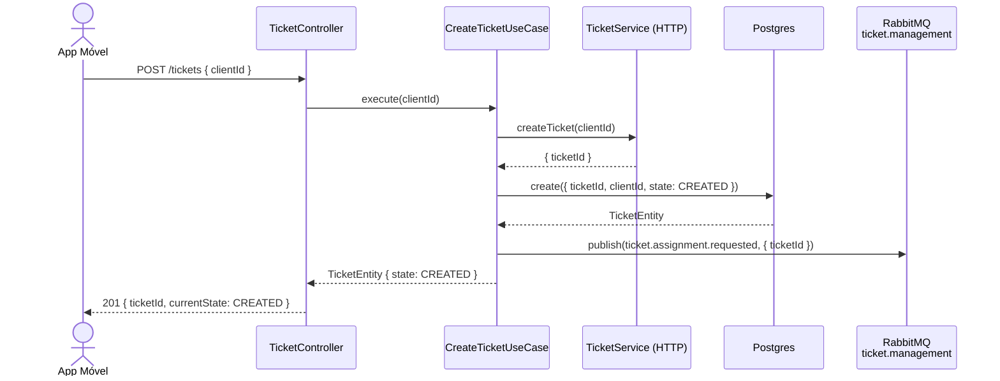
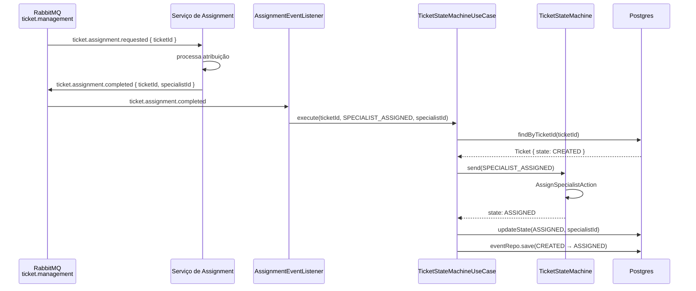
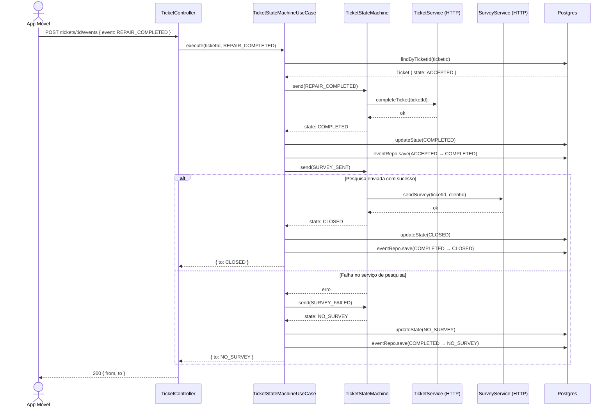

# Fluxo de Execução — Criação e Transição de Ticket

## 1. Criar um ticket — `POST /tickets`

### Fluxo síncrono — criação e publicação do evento

> O cliente recebe resposta imediatamente com o ticket em `CREATED`. A atribuição do especialista acontece de forma assíncrona.

---

### Fluxo assíncrono — atribuição de especialista

---

## 2. Concluir um ticket — `POST /tickets/:id/events`

> Em caso de falha na pesquisa, o ticket vai para `NO_SURVEY` e o app móvel recebe resposta normalmente — sem erro. O retry da pesquisa é tratado de forma eventual.
